# Research Document RAG Assistant 📚

An end-to-end, production-style **Retrieval-Augmented Generation (RAG)** application built in Python that allows users to upload multiple PDF documents and ask natural-language questions about their contents. 

The application retrieves semantically relevant information from the uploaded documents and uses a Large Language Model (LLM) hosted on Groq to generate answers **grounded strictly in the retrieved context**, providing exact page-level source citations.

---

## 1. Project Overview & Problem Statement

### The Problem
Large Language Models (LLMs) are powerful text generators, but they suffer from two major limitations:
1. **Knowledge Cutoffs**: They do not know about events or documents created after their training data was frozen.
2. **Hallucinations**: When asked about private or unfamiliar files, they often generate confident but false answers.
3. **No Private Access**: Out-of-the-box LLMs cannot read local research papers, lecture notes, or corporate documentation.

### The Solution: RAG (Retrieval-Augmented Generation)
This application implements the **RAG** pattern. When a user asks a question, the system acts like an "open-book exam": it searches the uploaded PDFs for the most relevant text chunks, compiles them into a structured prompt, and sends them to a hosted LLM to generate an answer. This guarantees that responses are fact-grounded, verifiable, and trace back to the exact pages in the source documents.

---

## 2. Features

- **Multi-PDF Upload**: Upload one or multiple research papers, articles, or lecture slides.
- **Local CPU Embeddings**: Generates dense vector representations of document text using the Hugging Face `all-MiniLM-L6-v2` model locally on your CPU.
- **FAISS Vector Database**: Builds and manages a local similarity-search index that persists on disk, avoiding expensive cloud database setups.
- **Context-Grounded Generation**: Restricts the Groq LLM (e.g., Llama 3) to answer questions using *only* the retrieved document text, reducing hallucinations.
- **Programmatic Source Citations**: Shows the exact file names and page numbers associated with the answer, extracted directly from chunk metadata.
- **Interactive UI**: Clean, responsive Streamlit dashboard featuring progress indicators, configurable chunk parameters (size, overlap, Top-K), and a conversation reset switch.
- **Local Debug Console**: An expandable debug view showing the retrieved text chunks along with their exact FAISS L2 similarity distance scores.
- **Session-Based Isolation**: Separates uploads and indexes using unique session IDs, protecting user privacy and preventing collection mix-ups.

---

## 3. How RAG Works (Data Flow)

The application separates text processing into **Ingestion** (offline prep) and **Querying** (online execution):

```mermaid
flowchart TD
    subgraph Data Ingestion
        A[Upload PDF files] --> B[fitz: Extract text & page metadata]
        B --> C[RecursiveTextSplitter: Split into chunks with overlap]
        C --> D[Hugging Face Local Embeddings: all-MiniLM-L6-v2]
        D --> E[FAISS Vector Index: Saved to data/indexes/]
    end

    subgraph Query Pipeline
        F[User Question] --> G[Generate Question Embedding]
        G --> H[Search FAISS index for Top-K chunks]
        H --> I[Format prompt with Context & Rules]
        I --> J[Groq API LLM Client]
        J --> K[Grounded Response + Programmatic Citations]
    end
```



---

## 4. Technology Stack

- **Core Logic**: Python 3.11
- **UI Framework**: Streamlit (for building interactive web interfaces)
- **PDF Extraction**: PyMuPDF (`fitz`) (fast, lightweight PDF parsing)
- **Orchestration**: LangChain & LangChain Community (for document loading, splitting, and vector store interfaces)
- **Embedding Model**: Hugging Face `all-MiniLM-L6-v2` (sentence transformers)
- **Vector Index**: FAISS CPU (Facebook AI Similarity Search)
- **LLM Provider**: Groq API (runs hosted inference in milliseconds)
- **Configuration**: `python-dotenv` (for managing local variables)
- **Testing**: Pytest (unit testing framework)

No dedicated GPU is required. The system runs on lightweight laptops.

---

## 5. Project Directory Structure

```text
research-document-rag/
│
├── app.py                     # Streamlit frontend application
├── requirements.txt           # Python package dependencies
├── .env.example               # Example environment variable file
├── .gitignore                 # Files and folders to ignore in Git
├── README.md                  # Complete documentation and setup guide
│
├── config/
│   └── settings.py            # Central configuration file for model names, chunk size, top_k
│
├── src/
│   ├── __init__.py
│   ├── pdf_processor.py       # PyMuPDF-based text and page extraction
│   ├── text_splitter.py       # LangChain RecursiveCharacterTextSplitter wrapper
│   ├── embeddings.py          # Hugging Face Sentence Transformers embeddings wrapper
│   ├── vector_store.py        # FAISS index creation, persistence, and loading
│   ├── retriever.py           # Top-K document retrieval and processing
│   ├── llm_client.py          # Groq API client for generation
│   ├── rag_pipeline.py        # Connects retrieval, prompt formatting, and generation
│   └── prompts.py             # System prompt and instruction strings
│
├── tests/
│   ├── test_pdf_processor.py  # Unit tests for text extraction
│   ├── test_text_splitter.py  # Unit tests for chunking and metadata preservation
│   └── test_retriever.py      # Unit tests for retrieval format and constraints
│
├── data/
│   ├── uploads/               # Directory for temporary uploaded PDFs
│   └── indexes/               # Directory for saving FAISS vector indexes
│
└── docs/
    ├── architecture.md        # Deep dive into how data moves and transforms
    └── interview_questions.md # Conceptual interview prep guide (25 questions + detailed answers)
```

---

## 6. Installation & Environment Setup

Follow these exact steps to set up and run the project locally on Windows:

### Step 1: Verify Python Installation
Open PowerShell and check your Python version (must be Python 3.11):
```powershell
python --version
```

### Step 2: Create a Virtual Environment
Create a clean isolated virtual environment inside your project folder:
```powershell
python -m venv .venv
```
*Why?* Virtual environments isolate project dependencies to prevent conflicts with libraries installed globally on your machine.

### Step 3: Activate the Virtual Environment
Activate the environment in PowerShell:
```powershell
.\.venv\Scripts\Activate.ps1
```
*(If you get an execution policy error, see the Troubleshooting guide below).*

### Step 4: Install Dependencies
Install all required packages from `requirements.txt`:
```powershell
pip install -r requirements.txt
```

### Step 5: Configure Environment Variables
1. Copy `.env.example` to create a new file named `.env`:
   ```powershell
   copy .env.example .env
   ```
2. Open `.env` and fill in your Groq API key (sign up for a free key at [console.groq.com](https://console.groq.com/)):
   ```env
   GROQ_API_KEY=gsk_your_actual_key_here
   LLM_MODEL=llama3-8b-8192
   ```

---

## 7. How to Run the Application

Start the Streamlit application:
```powershell
streamlit run app.py
```
This command spins up a local web server and automatically opens the application in your browser at `http://localhost:8501`.

---

## 8. Walkthrough / Example Usage

1. **Upload Documents**: Drag and drop one or more PDF research papers into the sidebar upload zone.
2. **Process**: Click the **Process Documents** button. You will see progress indicators displaying extraction and indexing.
3. **Ask Questions**: Type your question in the bottom chat input bar (e.g. *"What is the primary methodology used in this paper?"*).
4. **Inspect Sources**: Look at the **Sources Cited** output under the answer to verify page numbers.
5. **Debug Chunks**: Click on the **Debug: Show Retrieved Context** expander below the chat interface. You can read the raw text snippets matching your search alongside their mathematical FAISS distance scores.
6. **Reset State**: Click the sidebar's **Clear Documents & Reset** button to wipe all indexes, uploaded PDFs, and conversation history, restoring a blank workspace.

---

## 9. Troubleshooting Guide

### 1. Python Not Found
- **Error**: `python : The term 'python' is not recognized...`
- **Fix**: Re-run the Python installer, check **"Add Python to PATH"** at the bottom of the installer wizard, and restart PowerShell.

### 2. PowerShell Execution Policy Error
- **Error**: `...\Activate.ps1 cannot be loaded because running scripts is disabled on this system.`
- **Fix**: Set execution policies for the current session to bypass restriction:
  ```powershell
  Set-ExecutionPolicy -ExecutionPolicy RemoteSigned -Scope Process
  ```
  Then re-run `.\.venv\Scripts\Activate.ps1`.

### 3. FAISS Installation Issues
- **Error**: `ModuleNotFoundError: No module named 'faiss'`
- **Fix**: The FAISS CPU library is bundled under `faiss-cpu` in `requirements.txt`. If installation fails, manually install it via:
  ```powershell
  pip install --force-reinstall faiss-cpu
  ```

### 4. Invalid API Key / Rate Limits
- **Error**: `Groq API call failed: Authentication Error...` or HTTP 429
- **Fix**: Ensure your API key is correctly pasted in `.env` without spaces or quotation marks. If you hit rate limits, choose a smaller model like `llama3-8b-8192` in the sidebar.

### 5. PDF Extraction Failures (Blank / Scanned Pages)
- **Error**: `The file 'paper.pdf' contains no extractable text. It might be a scanned document...`
- **Fix**: This means the PDF is image-only. Use a searchable PDF text document. OCR is not implemented in this version.

---

## 10. Evaluation Methodology

Evaluating RAG systems requires testing two decoupled subsystems:
1. **Retrieval Evaluation**: Checks if the FAISS index retrieved the correct text chunks.
   - Measured using *Hit Rate* (did the top-4 chunks contain the target information?) and *Context Relevance*.
2. **Generation Evaluation**: Checks if the LLM synthesized an accurate answer using *only* the retrieved context.
   - Measured using *Faithfulness* (absence of hallucinations) and *Answer Relevance* (did it address the user question?).

### Manual Evaluation Checklist
To verify performance on a new document:
- [ ] **Ingestion Test**: Confirm document processes without warnings.
- [ ] **Relevance Check**: Verify that the top-K chunks in the Debug panel are relevant to your question.
- [ ] **Hallucination Test**: Ask a question completely outside the scope of the document (e.g., *"What is the recipe for chocolate cake?"*). Ensure the system responds: *"I could not find this information in the uploaded documents."*
- [ ] **Citation Audit**: Match the page cited in the UI with the actual PDF page to verify page-number accuracy.

---

## 11. Security and Privacy Safeguards

- **No API Keys in Repository**: Sensitive secrets are stored only in `.env` which is ignored by git via `.gitignore`.
- **Local Vector Processing**: All vector generation and searches happen locally on your CPU. No documents or text vectors are uploaded to external clouds.
- **Session-Based Isolation**: Documents and indexes are stored inside folders named with random UUIDs. Users cannot access each other's files.
- **Temporary Uploads**: The application deletes all temporary files and FAISS indices from disk when the user clicks the "Clear Documents & Reset" button.
- **File Validation**: Restricts uploads strictly to `.pdf` formats.

---

## 12. Future Improvements
- **Optical Character Recognition (OCR)**: Integrate Tesseract or PyTesseract to read scanned paper PDFs.
- **Hybrid Search**: Combine lexical BM25 search with dense vector similarity search to improve keyword recall.
- **Rerank Integration**: Add a second-stage Cross-Encoder (reranker) to re-order the retrieved chunks before prompt generation.
- **Table / Image Parsing**: Use layout-aware extraction libraries (like Unstructured or PyMuPDF table features) to preserve structural context.

---

## 13. Interview Preparation Reference
We have created a dedicated interview study guide at [docs/interview_questions.md](file:///d:/IIITL/proj/RAG/docs/interview_questions.md) containing 25 common interview questions with concise pitches and deep technical explanations. Use this guide to prepare for job interviews.

---

## 14. Resume-Ready Experience Entry

**Research Document RAG Assistant**
*Python, LangChain, Hugging Face, FAISS, Groq, Streamlit, Pytest*

Built an end-to-end Retrieval-Augmented Generation (RAG) web application for question answering over uploaded PDF documents. Implemented fitz (PyMuPDF) parsing, recursive character text chunking, local CPU vector embedding generation using Hugging Face's `all-MiniLM-L6-v2`, and FAISS-based semantic similarity indexing. Connected retrieval outputs to a hosted Groq LLM using strict system prompt formatting and zero-temperature configurations to minimize hallucinations. Engineered session-level UUID folder isolation for local data privacy, programmatically extracted page-level source citations directly from chunk metadata, and designed a Streamlit dashboard showing real-time FAISS distance scores for transparent model debugging. Added modular unit tests using Pytest to validate ingestion and retriever outputs.
