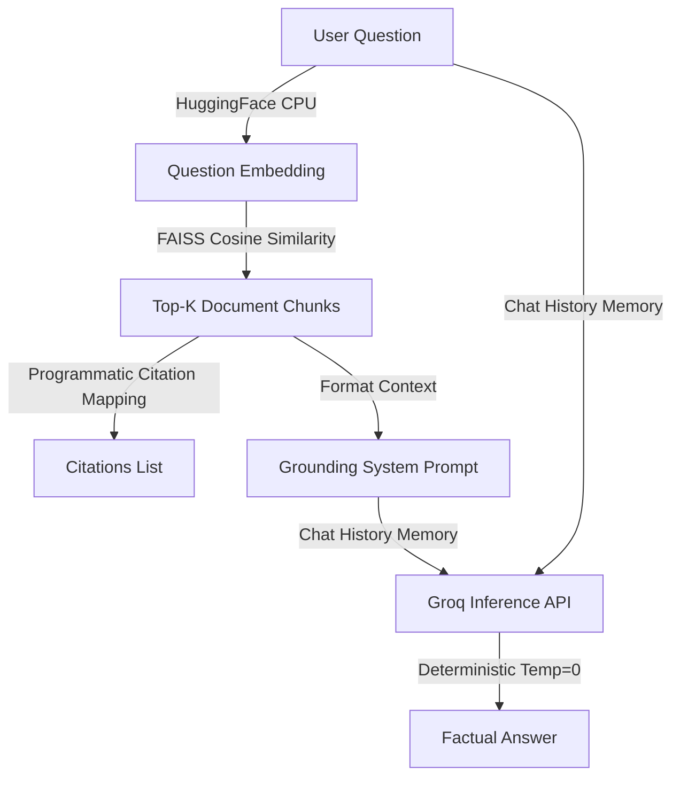

# Architecture Document: Research Document RAG Assistant

This document provides a detailed breakdown of the system architecture, data flows, component specifications, and key design decisions implemented in the **Research Document RAG Assistant**.

---

## 1. System Overview

The application is built on the **Retrieval-Augmented Generation (RAG)** architecture. It acts as a bridge between static local PDF documents and a generative LLM. Instead of sending raw, unstructured text to the model, the system partitions documents into mathematical representations, searches for relevant subsections based on query semantics, and feeds only the most relevant text to the LLM to yield grounded, factually verifiable answers.

---

## 2. Ingestion Flow (Data Prep)

The ingestion pipeline converts raw files into searchable vectors:


### 2.1 PDF Parsing (`src/pdf_processor.py`)
* **Technology**: PyMuPDF (`fitz`).
* **Mechanism**: Text is extracted page-by-page. For each page, we track the `page` (1-indexed) and `source` (file basename) metadata.
* **Exceptions**:
  - `EmptyPDFException`: File contains zero pages or is zero bytes.
  - `CorruptedPDFException`: File cannot be initialized by `fitz`.
  - `ScannedPDFException`: The total extracted characters from the entire document is zero, suggesting it is a scanned document without OCR.

### 2.2 Text Splitting (`src/text_splitter.py`)
* **Technology**: LangChain `RecursiveCharacterTextSplitter`.
* **Parameter Settings**: `CHUNK_SIZE = 800` characters, `CHUNK_OVERLAP = 150` characters.
* **Logic**: It recursively splits by double newlines (paragraphs), single newlines (sentences), spaces (words), and characters. This maximizes semantic cohesion by avoiding splitting sentences in half. Every child chunk inherits the parent page number and source file metadata.

### 2.3 Vector Embeddings (`src/embeddings.py`)
* **Technology**: `sentence-transformers/all-MiniLM-L6-v2` via `langchain-huggingface`.
* **Device**: Configured explicitly for **local CPU inference**.
* **Dimensions**: 384 dimensions.
* **Output**: A dense mathematical vector representing the semantic content of the chunk.

### 2.4 Vector Storage (`src/vector_store.py`)
* **Technology**: FAISS CPU (`langchain_community.vectorstores.FAISS`).
* **Mechanism**: Stores vectors, text contents, and metadata. Saved locally to `data/indexes/{session_id}`.
* **Sandboxing**: Uses a unique, session-based directory ID to isolate different users or upload states, avoiding mixing indexes.

---

## 3. Query Flow (Runtime Pipeline)

The query runtime pipeline manages retrieval and generation:



### 3.1 Similarity Retrieval (`src/retriever.py`)
* When a user queries, the question is mapped into a vector using the same local Hugging Face model.
* It compares the question embedding to the vector database using **L2 (Euclidean) distance** metrics.
* It extracts the `top_k` (default 4) closest chunks and lists their distances in the expandable debug UI.

### 3.2 Prompt Ingestion (`src/prompts.py` & `src/rag_pipeline.py`)
* Chunks are compiled into a formatted plain-text segment:
  ```text
  Source File: paper.pdf
  Page Number: 5
  Content: [extracted chunk text]
  ```
* This context is injected into the `SYSTEM_PROMPT`, forcing the model to only answer if the answer is contained within the context.

### 3.3 LLM Answering (`src/llm_client.py`)
* **Technology**: Groq API.
* **Model**: Fast inference with models like `llama3-8b-8192` or `mixtral-8x7b-32768`.
* **Temperature**: Set strictly to `0.0`. This restricts creativity and forces the LLM to choose words with the highest probability based on the prompt, reducing hallucination.

### 3.4 Programmatic Citations
* We do not rely on the LLM to invent page numbers. The citations are compiled programmatically from the metadata of retrieved chunks in `src/rag_pipeline.py` and rendered separately in the UI to ensure 100% citation accuracy.

---

## 4. Key Design Decisions

1. **Local Embeddings + Hosted LLM**: Generating embeddings locally on CPU is free and fast, keeping data parsing local. Using Groq for the generative LLM eliminates the need for expensive local GPU hardware while providing lightning-fast response generation.
2. **FAISS CPU**: Avoids setting up a complex, cloud-hosted database (like Pinecone or Milvus). The index is stored locally as binary files, making it fast and easy to reset.
3. **Session-Level Sandboxing**: Generates a UUID for every session, storing PDFs and indices in separate folders. Clicking "Reset" cleans the local workspace immediately, ensuring security and privacy.
